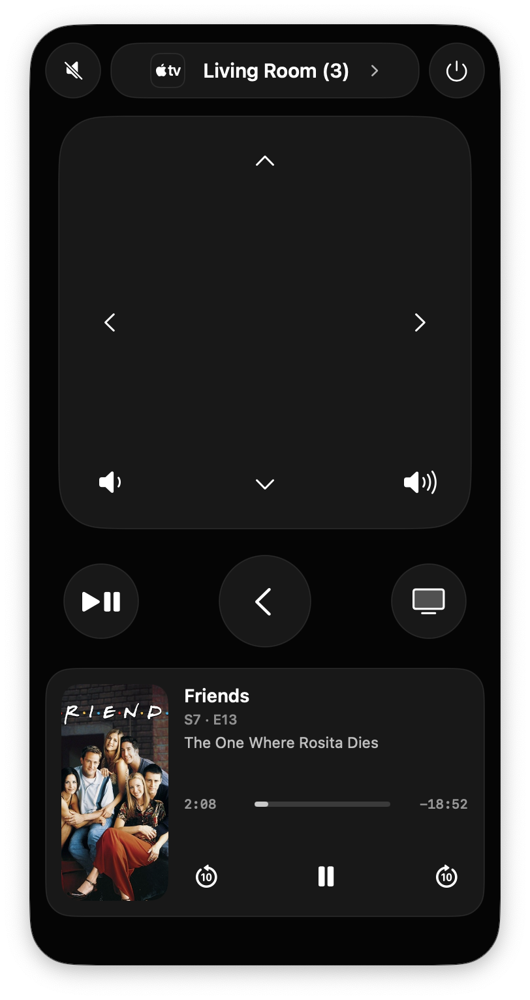
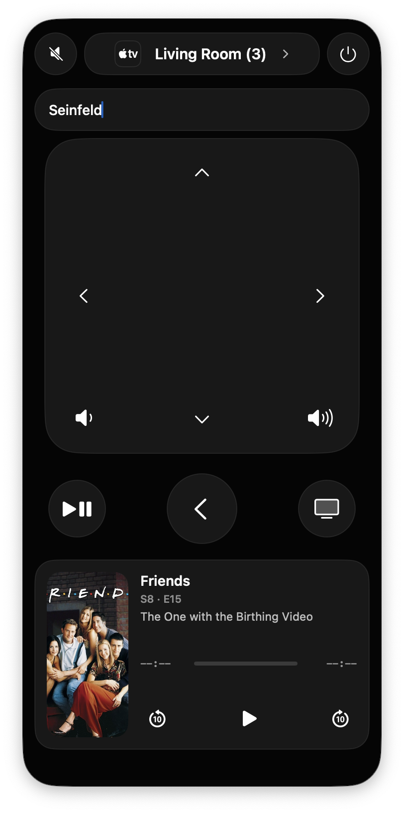
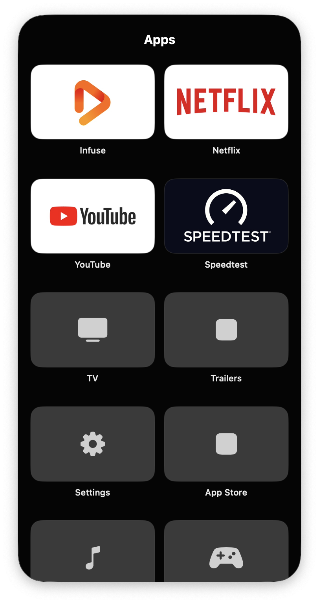
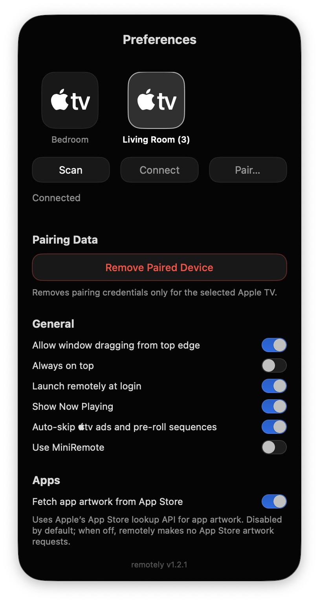
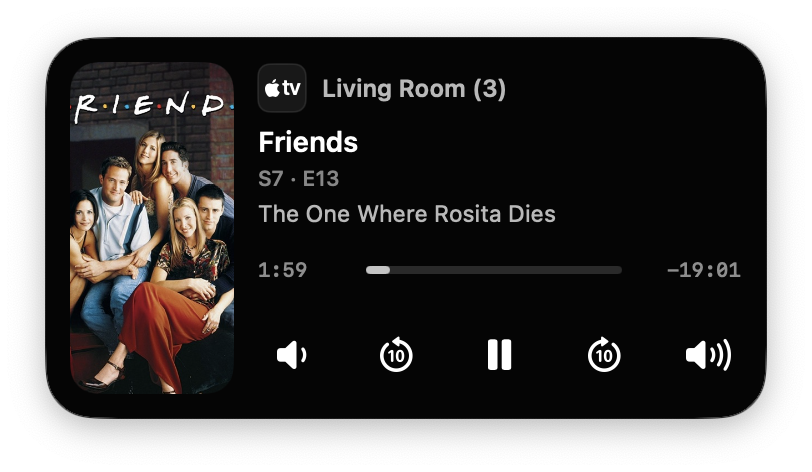

  

  Control your Apple TV from your Mac’s menu bar.

## Features

- Control navigation, playback, volume, and power with the remote or compact MiniRemote.
- See Now Playing artwork and playback details, seek on the timeline, and skip 10 seconds forward or back.
- Open installed Apple TV apps from your Mac and type with your Mac keyboard when Apple TV asks for text.
- Optionally skip supported ads and pre-roll in the Apple TV app.
- Keep the remote on top, remember its position, or launch Remotely at login.

  
  
  
  

  

## Install Remotely

You’ll need macOS 14 Sonoma or later and an Apple TV on the same local network as your Mac.

1. Open [GitHub Releases](https://github.com/introvertapp/remotely/releases) and download the ZIP for your Mac from the release’s **Assets**.

   | Mac | ZIP filename |
   | --- | --- |
   | Apple Silicon | `remotely-<version>-macos-arm64.zip` |
   | Intel | `remotely-<version>-macos-x86_64.zip` |

   Check **Apple menu → About This Mac** if you’re unsure which Mac you have.

2. Open the ZIP and move `remotely.app` into **Applications**.
3. Open Remotely from **Applications**. If macOS blocks the first launch, go to **System Settings → Privacy & Security**, choose **Open Anyway** for Remotely, and confirm. [Apple’s first-launch instructions](https://support.apple.com/102445)
4. Allow local network access if macOS asks. Remotely appears in the menu bar.

## Pair your Apple TV

1. Right-click the Remotely menu bar icon and choose **Preferences…**.
2. Select your Apple TV. If it’s missing from the list, click **Scan**.
3. Click **Pair…** and enter the four-digit code shown on your TV.
4. Click the menu bar icon to open the remote.

Remotely stores pairing credentials in your Mac’s Keychain so it can reconnect after you quit and reopen the app. To switch to another paired Apple TV, select it in **Preferences** and click **Connect**.

## Update Remotely

Quit Remotely from its menu bar menu, download the newer ZIP for your Mac, and replace `remotely.app` in **Applications**. If a saved pairing stops working, select the device in **Preferences**, click **Remove Paired Device**, and pair it again.

[Third-party notices](THIRD_PARTY_NOTICES.md)
